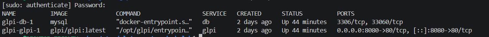
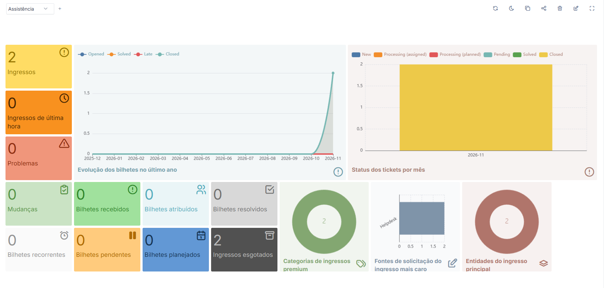

# 🖥️ GLPI Service Desk Lab

Laboratório prático de **Service Desk e Suporte Técnico N1**, construído com GLPI, Docker Compose e MySQL. O objetivo é praticar o registro de incidentes, a investigação inicial, o troubleshooting e a documentação técnica de atendimentos.

O ambiente é executado localmente e os chamados apresentados são cenários simulados. Cada atendimento possui uma página própria, com investigação, solução registrada, validação, limitações e evidências.

## 🛠️ Tecnologias utilizadas

| Tecnologia | Aplicação no projeto |
|---|---|
| GLPI | Registro e gerenciamento dos chamados |
| Docker Engine | Execução dos serviços em contêineres |
| Docker Compose | Orquestração do GLPI e do MySQL |
| MySQL | Banco de dados do GLPI |
| Linux / Ubuntu via WSL2 | Administração do ambiente |
| Windows | Laboratório de suporte a estações de trabalho |
| TCP/IP | Fundamentos de IPv4, DHCP, DNS e conectividade |
| Git e GitHub | Versionamento e documentação |

## 🖥️ Ambiente em execução

**Contêineres do GLPI e MySQL em execução com Docker Compose.**



**Painel do GLPI com os chamados registrados no laboratório.**



## 📋 Cenários de suporte

| Nº | Cenário | Status | Documentação |
|---|---|---|---|
| 01 | Computador sem acesso à internet | Concluído (simulado) | [Ver chamado](docs/chamados/01-sem-acesso-internet/README.md) |
| 02 | Inicialização lenta do Windows | Concluído (simulado) | [Ver chamado](docs/chamados/02-inicializacao-lenta/README.md) |
| 03 | Falha de acesso por proxy incorreto | Concluído em laboratório | [Ver chamado](docs/chamados/03-falha-proxy/README.md) |
| 04 | Falha ao conectar à VPN corporativa | Em investigação | — |
| 05 | Falha de resolução DNS no Windows | Concluído em laboratório | [Ver chamado](docs/chamados/05-falha-dns/README.md) |

> Somente cenários com documentação concluída possuem link. Os demais ainda não representam atendimentos finalizados.

## ⚙️ Como executar o ambiente

### Pré-requisitos

- Linux ou Ubuntu via WSL2;
- Docker Engine;
- Docker Compose v2 ou superior.

### 1. Clonar o repositório

```bash
git clone https://github.com/yuoproz/glpi-service-desk-lab.git
cd glpi-service-desk-lab
```

### 2. Configurar as variáveis de ambiente

```bash
cp .env.example .env
nano .env
```

Configure as credenciais conforme as variáveis esperadas pelo `docker-compose.yml`. O arquivo `.env` contém dados locais e não deve ser enviado ao GitHub.

### 3. Validar e iniciar os serviços

```bash
docker compose config --quiet
docker compose up -d
docker compose ps
```

Acesse o GLPI pelo navegador:

```text
http://localhost:8080
```

### 4. Parar os serviços

```bash
docker compose down
```

Esse comando remove os contêineres e preserva os volumes nomeados. Evite `docker compose down -v` quando quiser manter os dados do laboratório.

## 🎯 Competências praticadas

- Registro, classificação e acompanhamento de incidentes no GLPI;
- Investigação inicial e troubleshooting de estações de trabalho;
- Fundamentos de IPv4, DHCP, DNS e conectividade;
- Diagnóstico básico de desempenho no Windows;
- Execução e administração de serviços com Docker Compose;
- Administração básica de Linux via WSL2;
- Documentação técnica, registro de evidências e comunicação de limitações;
- Versionamento de projeto com Git e GitHub.

## 📌 Status do projeto

**Quatro cenários de suporte documentados**, sendo dois simulados e dois reproduzidos e validados em laboratório., com ambiente GLPI e MySQL executado localmente via Docker Compose. Os próximos cenários serão adicionados após a realização das atividades, validação dos resultados e organização das evidências.

> **Transparência:** os chamados deste laboratório são simulações para fins de estudo. Cada documentação diferencia as ações realmente executadas no computador de laboratório das hipóteses e etapas simuladas. Os resultados não devem ser interpretados como experiência de atendimento em ambiente corporativo real.
