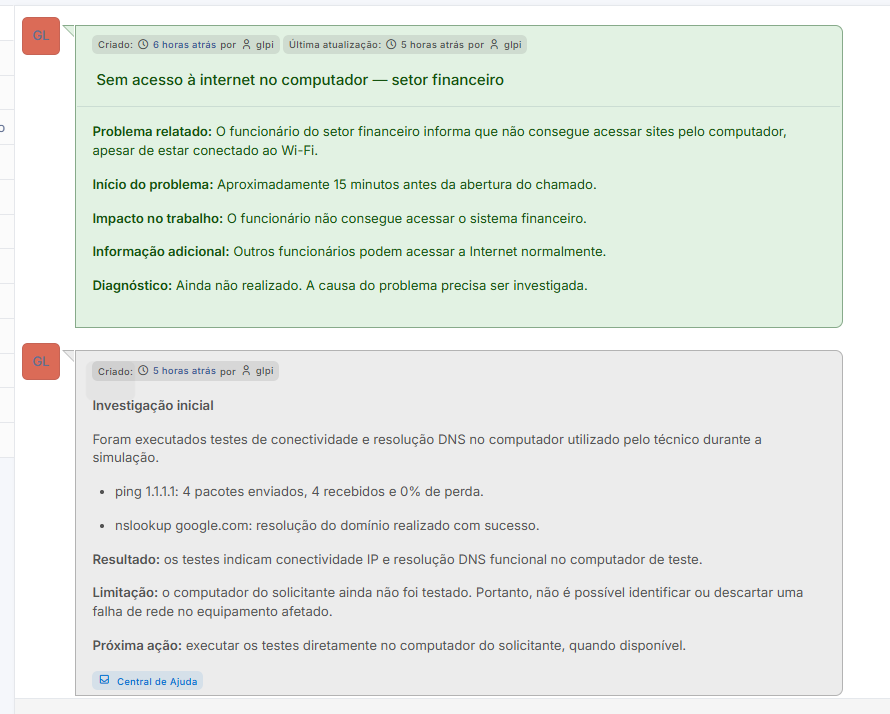
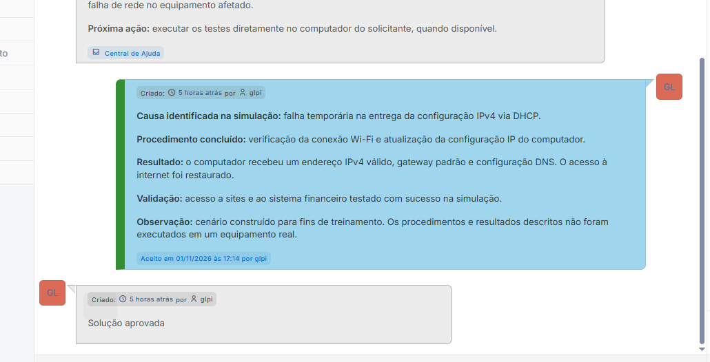
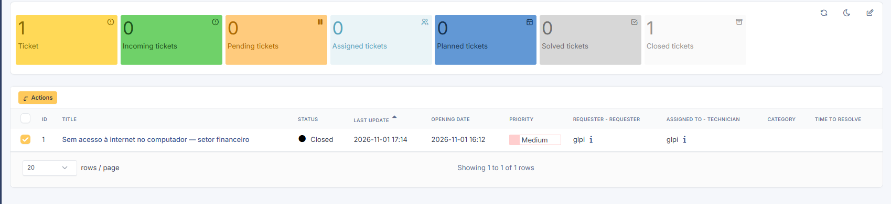

## 📋 Cenário do chamado simulado

**Título:** Sem acesso à internet no computador — setor financeiro.

**Problema relatado:** o usuário informa que está conectado ao Wi-Fi, mas não consegue acessar sites nem o sistema financeiro.

**Impacto:** as atividades do setor financeiro estão comprometidas no cenário proposto.

**Investigação inicial:** registro do incidente e planejamento dos testes necessários no computador do solicitante, incluindo a verificação da configuração IPv4, do gateway e do DHCP.

**Testes realizados no laboratório:** foram executados `ping 1.1.1.1` e `nslookup google.com` no computador utilizado pelo técnico. Houve resposta aos quatro pacotes enviados e resolução do domínio consultado.

**Hipótese de solução documentada:** falha temporária na obtenção da configuração IPv4 via DHCP, com proposta de renovação da configuração de rede e posterior validação da conectividade.

**Estado final:** chamado encerrado no GLPI após o registro e a aprovação da solução simulada.

> Os testes de rede foram executados no computador do técnico, não no equipamento fictício do solicitante. A falha DHCP não foi detectada experimentalmente. A solução registrada faz parte da simulação e não representa um reparo realizado em equipamento real.

## 📸 Evidências do projeto

**Histórico do chamado registrado no GLPI.**

**Solução simulada aprovada e registrada.**

**Lista de chamados registrados no GLPI.**

