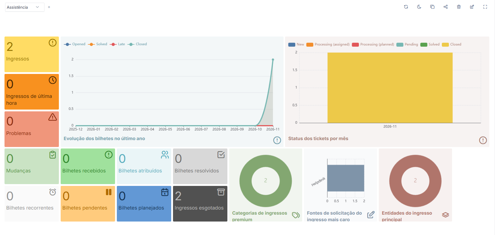
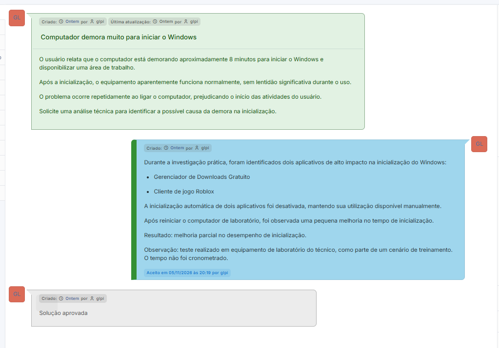
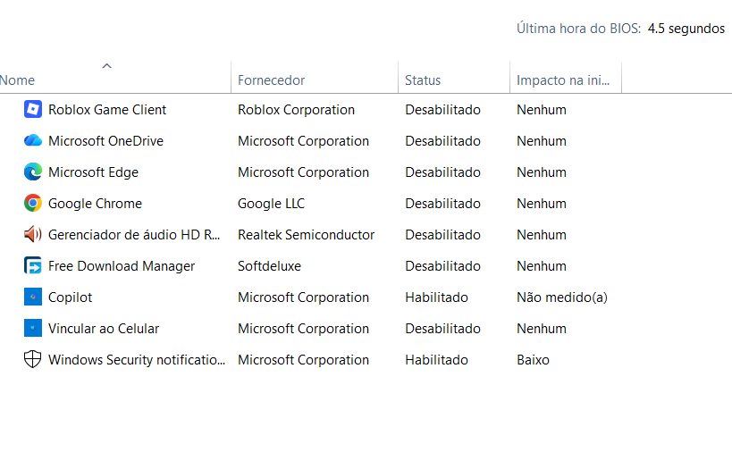

# Chamado 02 — Inicialização lenta do Windows

**Status:** Concluído (simulado) | **Prioridade:** Média | **Categoria:** Windows / Desempenho

## Cenário

O usuário relata que o computador demora aproximadamente oito minutos para iniciar o Windows e disponibilizar a área de trabalho. No cenário proposto, a demora atrasa o início das atividades profissionais.

## Investigação

1. Foi aberta a aba **Inicializar** do Gerenciador de Tarefas do Windows no computador utilizado pelo técnico.
2. Foram identificados quatro aplicativos classificados pelo Windows como de alto impacto na inicialização: Free Download Manager, Microsoft Edge, Microsoft OneDrive e Roblox Game Client.
3. Para testar uma possível contribuição desses programas, foi desativada a inicialização automática do Free Download Manager e do Roblox Game Client. Os programas continuaram disponíveis para abertura manual.
4. O computador foi reiniciado para observar o comportamento após a alteração.

Observação: Microsoft Edge e Microsoft OneDrive já estavam desabilitados antes do atendimento e não foram alterados durante o procedimento.

## Causa

**Possível contribuição de aplicativos na inicialização, sem confirmação de causa única.** A presença de programas com alto impacto indica que eles podem contribuir para a demora, mas os testes realizados não demonstraram que eram os únicos responsáveis pelo tempo de inicialização.

## Solução

Foi desativada a inicialização automática do Free Download Manager e do Roblox Game Client. A alteração reduz a quantidade de programas iniciados automaticamente, sem desinstalar os aplicativos.

## Validação

Após a reinicialização do computador de laboratório, foi observada uma pequena melhora no tempo de inicialização. A percepção não foi cronometrada, portanto não há uma medição antes/depois que permita quantificar o ganho. O atendimento simulado também foi registrado e encerrado no GLPI.

## Prevenção

Recomenda-se revisar periodicamente os aplicativos configurados para iniciar com o Windows, mantendo ativos os itens necessários ao trabalho e desativando somente programas não essenciais, com autorização do usuário. Em uma análise real, o tempo de inicialização deve ser medido antes e depois das alterações para comparar os resultados.

## Evidências

**Painel do GLPI com os chamados registrados.**

**Registro da investigação e da solução no chamado.**

**Estado dos aplicativos na aba Inicializar do Gerenciador de Tarefas após as alterações.**

## Limitações

- O cenário foi simulado no computador utilizado pelo técnico, não em uma estação de trabalho de um usuário real.
- O tempo inicial de aproximadamente oito minutos corresponde ao relato do cenário e não foi apresentado como uma medição independente.
- A melhora após a alteração foi apenas percebida, sem cronometragem.
- Como somente dois aplicativos tiveram a inicialização desativada, não foi possível confirmar que eles eram a única causa da lentidão.

## Competências praticadas

- Utilização do Gerenciador de Tarefas do Windows;
- Análise de aplicativos de inicialização;
- Troubleshooting básico de desempenho;
- Aplicação e validação de uma alteração de configuração;
- Registro e encerramento de chamados no GLPI;
- Documentação de resultados e limitações técnicas.
