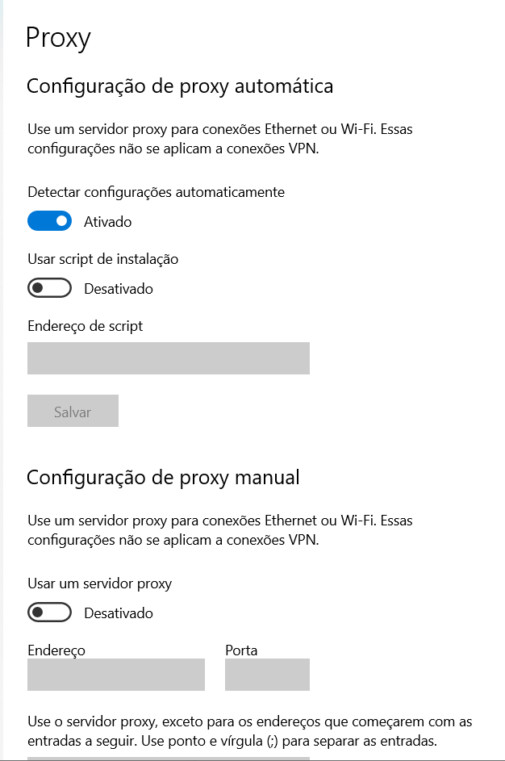
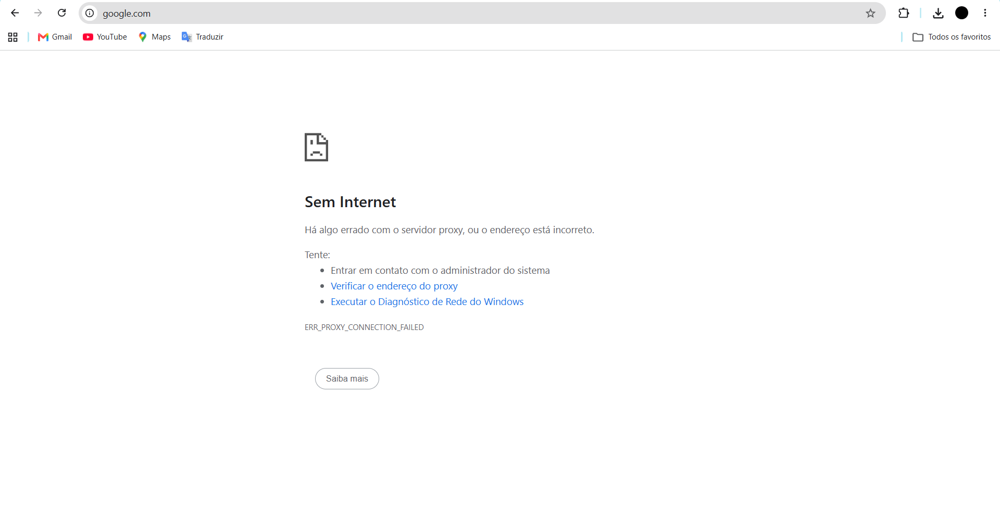
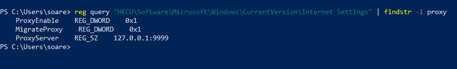
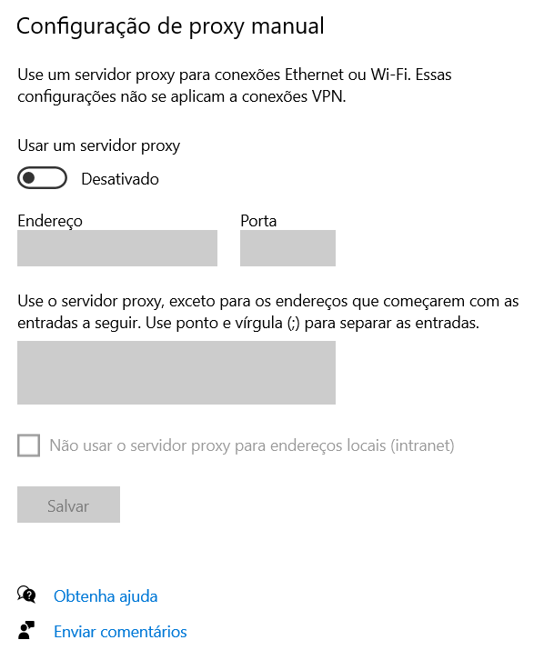
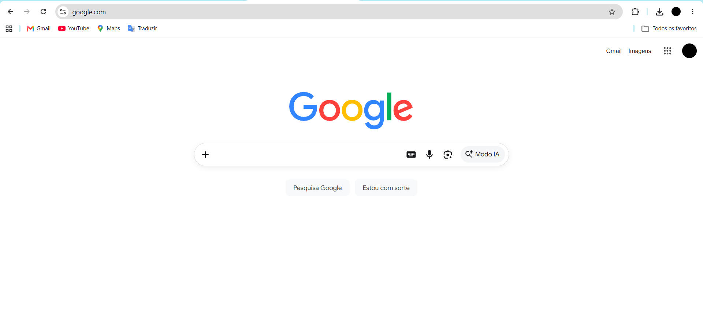

# Chamado 03 — Falha de acesso à internet por proxy incorreto

## 1. Cenário

Usuário relata que não consegue acessar páginas da internet pelo navegador, embora o computador esteja conectado à rede.

Ao tentar acessar sites, o Google Chrome apresenta o erro `ERR_PROXY_CONNECTION_FAILED`.

A falha foi reproduzida intencionalmente em um computador com Windows 10 para praticar diagnóstico e resolução de problemas de conectividade.

## 2. Investigação

Durante a investigação, foi reproduzida a falha por meio da configuração manual de um proxy inválido.

A consulta ao Registro do Windows confirmou:

- `ProxyEnable: 0x1` — proxy manual habilitado.
- `ProxyServer: 127.0.0.1:9999` — endereço e porta configurados.

O navegador apresentou o erro `ERR_PROXY_CONNECTION_FAILED`, indicando que não conseguiu estabelecer conexão com o proxy configurado.

## 3. Causa identificada

Configuração manual de proxy apontando para o endereço local `127.0.0.1`, na porta `9999`, sem um serviço proxy disponível para atender à conexão.

## 4. Solução aplicada

A configuração manual de proxy foi desativada em:

**Configurações do Windows → Rede e Internet → Proxy.**

## 5. Validação

Após desativar o proxy manual:

- O navegador voltou a acessar páginas da internet.
- O endereço `https://www.google.com` carregou normalmente.
- O erro `ERR_PROXY_CONNECTION_FAILED` deixou de ocorrer.

## 6. Prevenção

- Evitar alterações manuais de proxy sem orientação técnica.
- Verificar as configurações de proxy durante o diagnóstico de falhas de navegação.
- Em ambientes corporativos, controlar essas configurações conforme as políticas de TI.

## 7. Evidências

### 01 — Estado inicial do proxy

### 02 — Erro apresentado no Chrome

### 03 — Verificação no Registro do Windows

### 04 — Proxy manual desativado

### 05 — Acesso restabelecido

## 8. Limitações

A falha foi provocada intencionalmente no próprio computador para reproduzir o cenário. O usuário e o setor descritos no chamado são fictícios.

Os testes demonstram a reprodução, investigação e correção de uma configuração incorreta de proxy em ambiente de laboratório.

## 9. Competências praticadas

- Troubleshooting de conectividade no Windows.
- Configuração de proxy.
- Diagnóstico de erros de navegação.
- Consulta ao Registro do Windows.
- Identificação de causa raiz.
- Aplicação e validação de solução.
- Documentação técnica de incidentes.
