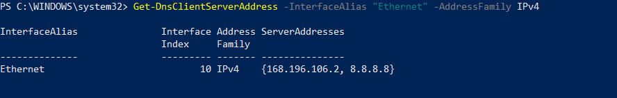
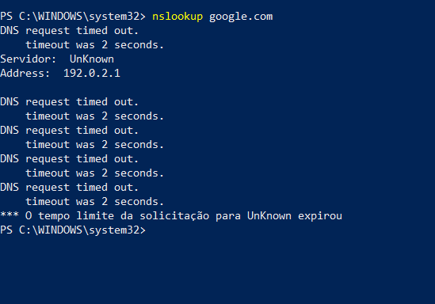
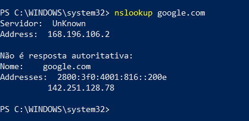

# Chamado 05 — Falha de resolução DNS no Windows

## Cenário
Usuário relata que não consegue acessar sites pelo nome de domínio, embora o computador esteja conectado à rede. O cenário foi reproduzido intencionalmente em laboratório para praticar diagnóstico de falhas de resolução DNS no Windows.

## Investigação
Foi verificada a configuração DNS da interface de rede Ethernet utilizando PowerShell.

A configuração original identificada era:
- DNS primário: `168.196.106.2`
- DNS secundário: `8.8.8.8`

Para reproduzir a falha, foi configurado intencionalmente o endereço `192.0.2.1` como único servidor DNS da interface.

Em seguida, foi executado:

`nslookup google.com`

O comando retornou mensagens `DNS request timed out`, indicando que o servidor DNS configurado não respondeu à consulta.

## Causa identificada
Configuração de um servidor DNS inválido ou inacessível na interface Ethernet.

## Solução aplicada
A configuração DNS original foi restaurada por meio do PowerShell:

`Set-DnsClientServerAddress -InterfaceAlias "Ethernet" -ServerAddresses "168.196.106.2","8.8.8.8"`

## Validação
Após a restauração, foi executado novamente `nslookup google.com`.

A consulta retornou endereços IP, confirmando que a resolução DNS voltou a funcionar.

## Prevenção
- Verificar os servidores DNS configurados na interface de rede.
- Utilizar servidores DNS válidos e acessíveis.
- Testar a resolução de domínios com `nslookup`.
- Registrar alterações realizadas durante o troubleshooting.

## Evidências

### 01 — Configuração DNS original recuperada

### 02 — Falha de resolução DNS reproduzida

### 03 — Resolução DNS restaurada

## Limitações
Cenário reproduzido em laboratório no próprio computador Windows. Não representa atendimento realizado em ambiente corporativo ou em equipamento de um usuário externo.

## Competências praticadas
- Troubleshooting de DNS no Windows.
- Configuração de servidores DNS via PowerShell.
- Diagnóstico com `nslookup`.
- Identificação e correção de configuração de rede.
- Registro técnico de incidentes.
